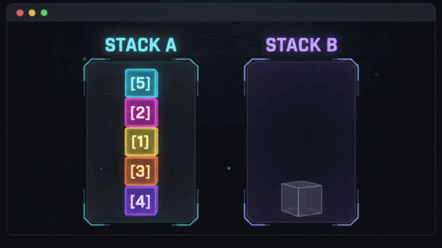
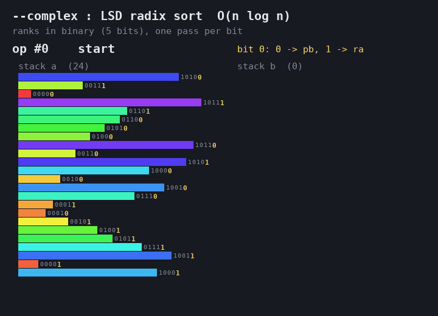

*This activity has been created as part of the 42 curriculum by ketolba, hugdelie.*

# push_swap


## Description

`push_swap` is a sorting project with constraints. The program receives a list
of integers (stack **a**), has a second empty stack (**b**), and must print on
the standard output a list of operations that sorts **a** in ascending order
(smallest number on top). The goal is not only to sort, but to use **as few
operations as possible**.

The project asks for four strategies inside the same binary:

| Flag | Strategy | Class (in number of operations) |
|------|----------|---------------------------------|
| `--simple` | Selection sort (min extraction) | O(n²) |
| `--medium` | Chunk sort (√n chunks) | O(n√n) |
| `--complex` | Binary LSD radix sort | O(n log n) |
| `--adaptive` *(default)* | Chooses one of the three from the **disorder** of the input | depends on the regime |

### Allowed operations

| Op | Effect |
|----|--------|
| `sa` / `sb` / `ss` | swap the first two elements of a / b / both |
| `pa` | take the top of b and put it on top of a |
| `pb` | take the top of a and put it on top of b |
| `ra` / `rb` / `rr` | rotate up: the first element becomes the last |
| `rra` / `rrb` / `rrr` | reverse rotate: the last element becomes the first |

```
   pb  →            ra (rotate up)        rra (rotate down)
 a      b          a                     a
[3]    [ ]        [3]   [1]             [3]   [2]
[1]    [ ]   →    [1] → [2]             [1] → [3]
[2]    [ ]        [2]   [3]             [2]   [1]
```

## Instructions

### Compilation

```bash
make        # builds libft, ft_printf, then push_swap (cc -Wall -Wextra -Werror)
make clean  # removes object files
make fclean # removes object files and binaries
make re     # fclean + all
```

### Usage

```bash
./push_swap [--bench] [--simple | --medium | --complex | --adaptive] <numbers...>
```

- The first number is the **top** of stack a.
- Operations are printed on **stdout**, one per line.
- No argument → nothing is printed.
- Invalid input (not an integer, out of `int` range, duplicate, unknown flag)
  → `Error` on **stderr**.
- `--bench` must be the **first** argument. It prints on **stderr**, after
  sorting: the disorder, the strategy used and its class, the total number of
  operations and the count of each operation.

### Examples

```bash
$> ./push_swap 2 1 3 6 5 8
$> ./push_swap --complex 4 67 3 87 23 | ./checker_linux 4 67 3 87 23
OK
$> ARG=$(shuf -i 0-9999 -n 500 | tr '\n' ' '); ./push_swap $ARG | wc -l
$> ./push_swap --bench --adaptive 4 67 3 87 23 2> bench.txt | ./checker_linux 4 67 3 87 23
OK
$> cat bench.txt
[bench] disorder: 40%
[bench] strategy: Adaptive / O(n√n)
[bench] total_ops: 9
[bench] sa: 0 sb: 0 ss: 0 pa: 2 pb: 2
[bench] ra: 4 rb: 0 rr: 0 rra: 1 rrb: 0 rrr: 0
$> ./push_swap 1 2 two
Error
```

## Algorithms

### Preparation: ranks and disorder

**Ranks.** After parsing, every value is replaced by its **rank**: 0 for the
smallest, n‑1 for the biggest (`ft_assign_rank`). The values `-50 3 1000`
become `0 1 2`. This makes chunks and bits easy to compute and does not depend
on the real values. It costs O(n²) comparisons in C, but **zero** push_swap
operations.

**Disorder** (`ft_check_sort`). Before any move, we count every pair (i, j)
with i before j and `a[i] > a[j]` (a "mistake", also called an *inversion*),
then divide by the total number of pairs n(n‑1)/2.

```
 2 1 3   pairs: (2,1) ✗  (2,3) ✓  (1,3) ✓   → disorder = 1/3 = 33%
 1 2 3   no mistake                         → 0%   (already sorted)
 3 2 1   all pairs are mistakes             → 100% (reversed)
```

If the stack is already sorted, nothing is printed. If it has **5 numbers or
less**, a hand-written sort is always used (see *Small inputs*).

### 1. Simple — selection sort, O(n²)


```
repeat until a is empty:
    bring the minimum of a to the top (ra or rra, the shortest way)
    pb
pa until b is empty
```

b receives the numbers from smallest to biggest, so b holds them in
reverse order; pushing everything back gives a sorted a.

**Cost.** Bringing the min to the top costs at most n/2 rotations, done n
times, plus n `pb` and n `pa`:
`ops ≤ n·n/2 + 2n` → **O(n²)**. Extra space: O(1) (only the two stacks, O(n)).

**Why this one.** It is the easiest correct algorithm and its cost depends a
lot on the order of the input: when the input is almost sorted, the minimum
is often already on top or very close, so rotations are rare.

### 2. Medium — chunk sort, O(n√n)


Ranks are split into k = ⌈√n⌉ chunks of about √n values (`ft_get_chunk_size`).

```
 n = 100  →  chunk size 10:  [0..9] [10..19] ... [90..99]

 for each chunk, from the smallest:
   1. ft_push_chunk : scan a, pb the elements of the chunk, ra the others
   2. ft_bring_for_next_chunk : rotate a so the previous chunk is at the bottom
   3. ft_target_pa  : put the chunk back into a in order
        top of b == smallest missing → pa + ra (goes under the sorted part)
        top of b == biggest missing  → pa      (waits on top)
        otherwise                    → rb
 finally rotate a so the sorted part is in place
```

**Cost (upper bound).**
- step 1: at most n rotations per chunk → √n · n
- step 3: for each of the √n elements of a chunk, at most √n `rb` → √n · √n = n per chunk → √n · n
- step 2: at most n/2 rotations per chunk → √n · n/2

Total: **O(n√n)**. Extra space: O(1) (a few ints).

**Why this one.** Working on a small group of values at a time keeps b short,
so finding the next element in b is cheap. √n is the size that balances the
two costs: bigger chunks make step 3 slower, smaller chunks make step 1 slower.

### 3. Complex — LSD binary radix sort, O(n log n)



Ranks go from 0 to n‑1, so they fit in b = ⌈log₂ n⌉ bits (7 bits for 100, 9 bits
for 500).

```
for bit = 0 to b-1:          (least significant bit first)
    n times: if this bit of the top of a is 0 → pb, else → ra
    pa until b is empty
```

After each pass the stack is sorted on the bits already seen; after the last
pass, it is fully sorted.

**Cost.** Each pass is exactly n operations (`pb` or `ra`) plus at most n `pa`:
`ops ≤ 2n·⌈log₂ n⌉` → **O(n log n)**. Extra space: O(1).

**Why this one.** It is simple, always correct, and does not depend on the
order of the input: the number of operations is the same for every input of
the same size (1084 for 100 numbers, 6784 for 500). It is the safe choice when
the input is very mixed.

### 4. Adaptive (default)

```
 disorder < 20%          → simple   O(n²)
 20% ≤ disorder < 50%    → medium   O(n√n)
 disorder ≥ 50%          → complex  O(n log n)
```

**Rationale for the thresholds.**
- The three regimes and the class required in each are imposed by the subject.
- **Low disorder (< 20%)**: the numbers are mostly in place, so the minimum is
  usually near the top; selection sort makes few rotations and beats radix,
  which always pays its full fixed cost.
- **Medium disorder (20–50%)**: selection sort starts to rotate a lot, while
  chunk sort keeps a cost close to its random-input cost.
- **High disorder (≥ 50%)**: the input is close to random (a random list has
  about 50% disorder); radix gives the best and most stable result.

**Complexity.** Each regime calls exactly one strategy, so its bound is the
bound of that strategy: O(n²), O(n√n) and O(n log n). Measuring the disorder and
computing ranks costs O(n²) in C but no push_swap operation. Space: O(n) for the
two stacks, O(1) extra.

### Small inputs (≤ 5 numbers)

- 2 numbers: `sa` if needed.
- 3 numbers: one of the 6 possible orders, solved with at most 2 operations
  (`ft_sort_three`).
- 4–5 numbers: push the 1 or 2 smallest to b, sort 3, push them back
  (`ft_sort_five`).

## Results

Measured on 20 random inputs per line, all validated by a checker.

| Size | `--simple` | `--medium` | `--complex` | `--adaptive` |
|------|-----------:|-----------:|------------:|-------------:|
| 100  | ~1440 | ~1010 | 1084 | ~1060 |
| 500  | ~32150 | ~10300 | 6784 | 6784 or ~10300 (*) |

(*) A random list of 500 has a disorder very close to 50%: depending on the
draw, adaptive uses radix (≥ 50%) or chunk sort (< 50%).

Effect of disorder (one input per line):

| Size | Disorder | `--simple` | `--medium` | `--complex` |
|------|---------:|-----------:|-----------:|------------:|
| 100 | 5%  | **464** | 549 | 1084 |
| 100 | 30% | 1183 | **943** | 1084 |
| 500 | 5%  | 7233 | **6732** | 6784 |
| 500 | 30% | 25931 | 10173 | **6784** |

## Project structure

```
.
├── Makefile
├── includes/push_swap.h        # t_stack, t_ops enum, prototypes
├── src/
│   ├── push_swap.c             # main: parse, measure disorder, sort, bench
│   ├── sa.c … rrr.c            # the 11 operations (each one counted in ops[])
│   ├── ft_init_stack.c, ft_error_check.c, ft_checkinput.c,
│   │   ft_checkduplicate.c, ft_checkintrange.c, ft_flag.c, ft_check_flag.c
│   ├── ft_assign_rank.c        # ranks
│   ├── ft_check_sort.c         # disorder
│   ├── ft_sorting_strategy.c, ft_select_sort.c   # strategy choice
│   ├── ft_selection_sort.c     # simple
│   ├── ft_chunk_sort.c, ft_push_chunk.c, ft_target_pa.c, ft_bring_to_next_chunk.c  # medium
│   ├── ft_sort_radix.c         # complex
│   ├── ft_short_sort.c, ft_sort_three.c, ft_sort_five.c  # ≤ 5 numbers
│   └── ft_bench.c, ft_log_type.c                 # --bench
├── libft/                      # our libft
└── printf/                     # our ft_printf
```

## Contributions

Both learners worked on the whole project together and can explain every part
of it.

- **ketolba**: parsing and stack creation, ranks, the 11 operations, sort of 3
  and 5, selection sort, chunk sort, radix sort, strategy selection,
  `--bench` mode, error handling of flags, memory leak fixes, README.
- **hugdelie**: disorder metric (`ft_check_sort`), flag handling in `main`,
  `ft_short_sort` integration, Makefile, crash (segfault) fixes, Norm
  compliance.

## Resources

- [Sorting algorithm — Wikipedia](https://en.wikipedia.org/wiki/Sorting_algorithm)
- [Selection sort — Wikipedia](https://en.wikipedia.org/wiki/Selection_sort)
- [Radix sort — Wikipedia](https://en.wikipedia.org/wiki/Radix_sort)
- [Inversion (discrete mathematics) — Wikipedia](https://en.wikipedia.org/wiki/Inversion_(discrete_mathematics)) — the idea behind the disorder metric
- [Big O notation — Wikipedia](https://en.wikipedia.org/wiki/Big_O_notation)
- *Introduction to Algorithms* (Cormen, Leiserson, Rivest, Stein) — sorting and complexity chapters

### Use of AI

- AI (Claude) was used to help **write and structure this README**: it read the
  subject and our code, ran the program on test inputs to get the operation
  counts, and drafted the algorithm explanations and complexity arguments. We
  reviewed and corrected the text.
- AI was **not** used to write the C code of the project. The algorithms were
  designed, written and debugged by us.
